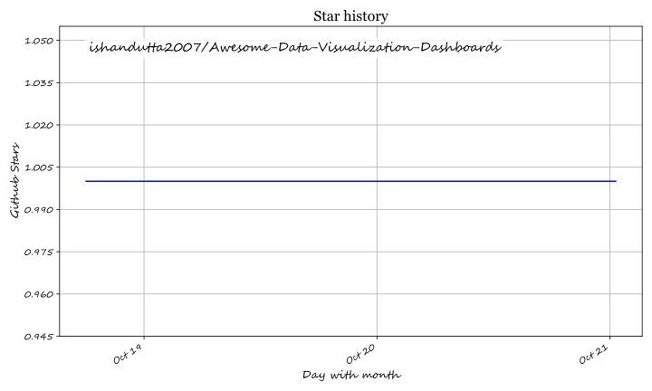

# 📊 Awesome Data Visualization & Dashboards

**A curated directory of top-tier Business Intelligence (BI) SaaS platforms, open-source dashboard tools, time-series observability suites, and interactive charting libraries.**

*Track the evolution of visual analytics, real-time metrics, semantic layers, and embedded data visualization.*

[Explore SaaS](#-saashosted-platforms) • [Open-Source Tools](#-open-source-github-projects) • [Market Dynamics](#-sector-overview--market-dynamics) • [Contributing](#-how-to-contribute) • [Support](#-support)

---

## 📌 Table of Contents

- [🌐 Sector Overview & Market Dynamics](#-sector-overview--market-dynamics)
- [☁️ SaaS/Hosted Platforms](#-saashosted-platforms)
- [⚡ Open-Source GitHub Projects](#-open-source-github-projects)
- [🛠️ Architectural Guidance & Selection Matrix](#-architectural-guidance--selection-matrix)
- [🤝 How to Contribute](#-how-to-contribute)
- [📈 Star History](#-star-history)
- [💖 Support](#-support)
- [⚖️ Disclaimer](#-disclaimer)

---

## 🌐 Sector Overview & Market Dynamics

The global data visualization and business intelligence market is valued at approximately **$30 billion to $36 billion**, projected to surpass **$60 billion by 2032** at an ~11% CAGR driven by real-time observability, embedded analytics, and generative AI copilot integrations. 

The sector exhibits **moderate fragmentation with strong consolidation at the top (oligopolistic core)**: tech titans (Microsoft, Salesforce, Google) command the enterprise market with deep bundled suites (Power BI, Tableau, Looker), while high specialized demand sustains a thriving, fast-moving ecosystem of niche solutions, semantic-first layers (dbt/Lightdash, Cube), and vibrant open-source self-hosted alternatives (Grafana, Superset, Metabase) avoiding vendor lock-in.

---

## ☁️ SaaS/Hosted Platforms

| Product | Company / Parent | Company Size (Valuation / Market Cap / Revenue) | Starting Price | Free Tier / Trial Limits | Description |
| :--- | :--- | :--- | :--- | :--- | :--- |
| **[Microsoft Power BI](https://powerbi.microsoft.com/)** | Microsoft | ~$3.1T Market Cap (~$245B+ Annual Revenue) | **$14/user/month** (Power BI Pro, billed annually) | **Free Desktop Edition & Personal Cloud Workspace**: Free authoring via Power BI Desktop, but report sharing and team collaboration are blocked without paid Pro/Premium or capacity license | Microsoft's enterprise business analytics platform integrated with Fabric, featuring Copilot AI assistance and Direct Lake querying. |
| **[Google Looker Studio](https://lookerstudio.google.com/)** | Alphabet (Google) | ~$2.1T Market Cap (~$350B+ Annual Revenue) | **$0** (Looker Studio standard); **$9/user/project/month** (Looker Studio Pro) | **100% Free Forever**: Unlimited reports, sharing, and standard connectors (Google Analytics, BigQuery sandbox, Sheets). Pro tier adds team workspaces and asset management with a 30-day free trial | Google's accessible cloud BI and reporting tool with real-time collaboration and seamless Google Workspace integration. |
| **[Looker (Google Cloud Core)](https://cloud.google.com/looker)** | Alphabet (Google) | ~$2.1T Market Cap (~$350B+ Annual Revenue) | **~$60,000/year** (~$5,000/month base platform fee for Standard edition) | **30-day Free Trial**: No permanent free-forever tier; 30-day cloud trial instance available with Google Cloud trial credits for evaluation | Code-based enterprise semantic modeling platform powered by LookML, Git-integrated version control, and robust embedded analytics. |
| **[Tableau](https://www.tableau.com/)** | Salesforce | ~$280B Market Cap (~$38B+ Annual Revenue; acquired for $15.7B) | **$15/user/month** (Viewer, billed annually); **$75/user/month** (Creator) | **14-day Free Trial** (Tableau Cloud/Desktop Creator); **Tableau Public** is free-forever but all data/worksheets are 100% public (up to 15M rows, 10GB storage); **Desktop Free Edition** restricts sharing/publishing | The visual analytics benchmark featuring drag-and-drop dashboarding, Tableau Pulse for AI insights, and deep chart customization. |
| **[Qlik Sense](https://www.qlik.com/us/products/qlik-sense)** | Qlik (Thoma Bravo / ADIA) | ~$10B Valuation (~$1B+ Annual Revenue) | **$300/month** (Starter tier for up to 10 users & 10 GB data, billed annually) | **30-day Free Trial**: No permanent free-forever tier; 30-day trial environment of Qlik Cloud with full Associative Engine access and capped storage | Associative analytics engine discovering relationships across enterprise data without predefined queries, plus self-service and embedded analytics. |
| **[Sisense](https://www.sisense.com/)** | Sisense | ~$1.1B Valuation (~$140M–$150M ARR) | **~$10,000/year** (~$833/month starting base deployment) | **14-day Free Trial**: No permanent free-forever tier; 14-day sandbox/test drive environment with sample data connectors and core dashboard capabilities | Analytics platform specialized for embedded analytics and customer-facing products with ElastiCube in-memory data blending and predictive AI. |
| **[Domo](https://www.domo.com/)** | Domo, Inc. | ~$150M Market Cap (~$319M Annual Revenue; agreed $400M platform acquisition by Progress Software) | **~$30,000/year** (~$2,500/month credit-based consumption tier with unlimited seats) | **30-day Free Trial**: No permanent free-forever tier; 30-day enterprise evaluation trial with unlimited user seats, 1,000+ connectors, and Magic ETL | Cloud-native BI and data platform offering 1,000+ data connectors, Magic ETL data transformation pipelines, and AI-driven workflow apps. |

---

## ⚡ Open-Source GitHub Projects

*Ranked strictly by GitHub stargazers count (descending) with live social Stars_Badges.*

| Project | GitHub_Stars | Focus & Architecture | License | Description |
| :--- | :--- | :--- | :--- | :--- |
| **[D3.js](https://github.com/d3/d3)** |  | Low-level Data Visualization Grammar | ISC | **The definitive JavaScript library for bespoke data visualization.** Operates directly on the DOM using Web standards (SVG, Canvas, HTML) with powerful data-driven transformations, scales, and math utilities. |
| **[Grafana](https://github.com/grafana/grafana)** |  | Operational Observability & Metrics | AGPL-3.0 | **The world's leading open-source observability and time-series dashboard engine.** Features dynamic dashboards, 170+ data source plugins, automated alerting, DORA metrics, and 2-way Git workflows. |
| **[Apache Superset](https://github.com/apache/superset)** |  | Enterprise SQL-Native BI | Apache-2.0 | **Modern, cloud-native enterprise business intelligence platform.** Features an intuitive no-code chart builder, SQL Lab query IDE, lightweight semantic layer, caching, and native Apache ECharts integration. |
| **[Chart.js](https://github.com/chartjs/Chart.js)** |  | Canvas-based HTML5 Charting | MIT | **Simple yet flexible JavaScript charting library for designers & developers.** Renders crisp, responsive HTML5 canvas charts across 8 distinct chart types with smooth transitions and animation. |
| **[Apache ECharts](https://github.com/apache/echarts)** |  | Interactive Web Charting Engine | Apache-2.0 | **High-performance, rich visualization library.** Powers Apache Superset visualizations with declarative multi-coordinate mapping, 3D rendering, canvas/SVG options, and fluent interaction. |
| **[Metabase](https://github.com/metabase/metabase)** |  | Self-Service Business Analytics | AGPL-3.0 | **The easiest way for everyone in an organization to ask questions and learn from data.** 5-minute setup, no-code visual query builder, SQL editor, Metabot AI assistance, and rich dashboard subscriptions. |
| **[Appsmith](https://github.com/appsmithorg/appsmith)** |  | Low-Code Internal Tooling & Dashboards | Apache-2.0 | **Open-source low-code platform to build custom analytics dashboards, admin panels, and CRUD apps.** Connects seamlessly to SQL databases, REST/GraphQL APIs, and SaaS apps with drag-and-drop UI widgets. |
| **[Redash](https://github.com/getredash/redash)** |  | SQL-First Query & Visualizations | BSD-2-Clause | **Lightweight, developer-centric data visualization and dashboarding platform.** Enables SQL teams to query databases, visualize results into shareable dashboards, and set threshold alerts. |
| **[Elastic Kibana](https://github.com/elastic/kibana)** |  | Log & Search Analytics | Elastic / SSPL | **The visualization and exploration window into Elasticsearch.** Industry benchmark for operational log monitoring, security event tracking, APM, and real-time geospatial search analytics. |
| **[GoAccess](https://github.com/allinurl/goaccess)** |  | Terminal & Real-Time Web Log Viz | MIT | **Real-time web log analyzer and interactive viewer.** Generates fast terminal-based dashboards and dynamic HTML reports on the fly with sub-second response times and zero dependencies. |
| **[Cube](https://github.com/cube-js/cube)** |  | Universal Semantic Layer & API | Apache-2.0 | **The semantic layer for building data applications and customer-facing dashboards.** Provides centralized metric definition, pre-aggregation caching, access governance, and SQL/REST/GraphQL APIs. |
| **[Plotly.js](https://github.com/plotly/plotly.js)** |  | Scientific & Statistical Graphics | MIT | **Flagship JavaScript charting library backing Plotly and Dash.** Delivers scientific graphs, 3D plots, financial charts, choropleth maps, and MathJax equation integration for technical analysis. |
| **[Evidence](https://github.com/evidence-dev/evidence)** |  | Code-First Markdown Analytics | MIT | **Code-driven alternative to drag-and-drop BI.** Build fast, interactive data products and executive reports using SQL, Markdown, and version-controlled Git workflows. |
| **[Lightdash](https://github.com/lightdash/lightdash)** |  | dbt-Native Business Intelligence | MIT | **Open-source BI built specifically for dbt workflows.** Directly reads metrics defined inside your dbt transformation models, keeping business metrics and transformations in one single source of truth. |
| **[Observable Plot](https://github.com/observablehq/plot)** |  | Concise Grammar of Graphics | ISC | **Concise, exploratory visualization library from the creators of D3.** Designed for rapid visual exploratory data analysis (EDA) with clean expressive syntax and minimal boilerplate. |
| **[Rill](https://github.com/rilldata/rill)** |  | Real-Time Fast BI with DuckDB | Apache-2.0 | **BI-as-code platform engineered for sub-second, real-time analytics.** Combines an embedded DuckDB columnar engine with code-configured dashboards for lightning-fast metrics exploration. |

---

## 🛠️ Architectural Guidance & Selection Matrix

When architecting a data analytics or observability stack, select tools matching user archetypes rather than raw feature matrices:

1. **👥 Non-Technical & Business Teams (Self-Service Discovery)**
   - **Metabase**: The fastest entry point. 5-minute deployment, intuitive point-and-click Query Builder, automated AI query assistance, and frictionless report subscriptions.
   - **Google Looker Studio**: Zero-cost hosted entry point for marketing and operational metrics connected directly with Google Workspace and BigQuery.

2. **📊 Analytics Engineers & SQL Professionals (Data Modeling & Governed BI)**
   - **Apache Superset**: Best-in-class SQL IDE with SQLAlchemy connectivity to virtually any cloud warehouse (Snowflake, BigQuery, ClickHouse, Trino) and custom dashboarding.
   - **Lightdash**: Tailor-made for teams running dbt. Keep your semantic definitions in repository YAML files alongside transformation models.
   - **Cube**: Universal semantic layer providing caching, SQL/REST APIs, and metric consistency across multi-BI architectures.

3. **⚙️ Platform, DevOps & SRE Teams (Real-Time Observability)**
   - **Grafana**: The gold standard for infrastructure health, APM, Prometheus/Loki querying, latency tracking, dynamic templating, and automated alerting.
   - **Elastic Kibana**: Best for distributed log search, audit trails, and Elasticsearch/OpenSearch index visualization.

4. **💻 Developers & Custom Embedded Applications (Data-as-Code & Libraries)**
   - **Apache ECharts & Chart.js**: Performant, polished chart components ready for inclusion in React, Vue, or Angular applications.
   - **D3.js & Observable Plot**: The unmatched expressive grammar of graphics for novel visual structures and exploratory workflows.
   - **Evidence & Rill**: Code-first analytics, duckdb-backed speed, and reproducible markdown documents managed strictly in Git.

---

## 🤝 How to Contribute

Contributions, updates, and corrections are always welcome! 🚀

1. Fork the repository.
2. Create a descriptive branch: `git checkout -b feature/add-new-dashboard-tool`.
3. Add your entry following the established table structure (include official links, licenses, accurate Stars_Counts, and clear factual descriptions).
4. Ensure entries are categorized properly and sorted where applicable.
5. Submit a Pull Request with a brief explanation of the tool and rationale.

⭐ **Star the repo** if you find this ecosystem guide helpful!

---

## 📈 Star History

---

## 💖 Support

If you find this curated list valuable for your projects, engineering workflows, or technology evaluations:

- ⭐ **Star** this repository to help other developers and data teams discover it!
- 🍴 **Fork** and share it with your data analytics, engineering, and DevOps colleagues.
- ☕ **Sponsor & Buy a Coffee**: Support ongoing maintenance and curated technical repositories via the [GitHub Sponsor Dashboard](https://github.com/sponsors/ishandutta2007).

Thank you for being part of the open-source data community! 🙌

---

## ⚖️ Disclaimer

- This is a community-curated directory intended for research, evaluation, and informational purposes. It does not constitute a formal commercial endorsement.
- All product names, trademarks, and registered trademarks belong to their respective corporate owners.
- When choosing dashboard platforms processing customer or organizational data, ensure compliance with applicable data residency, security, and privacy regulations (GDPR, HIPAA, SOC 2).

---

**Empowering data analysts, platform engineers, and developers with open, transparent, and actionable dashboards.**

## ⭐ Star History

<a href="https://star-history.com/#ishandutta2007/Awesome-Data-Visualization-Dashboards&Timeline" align="center">
  <picture>
    <source media="(prefers-color-scheme: dark)" srcset="assets/ishandutta2007_Awesome-Data-Visualization-Dashboards_growth.svg">
    
  </picture>
</a>
